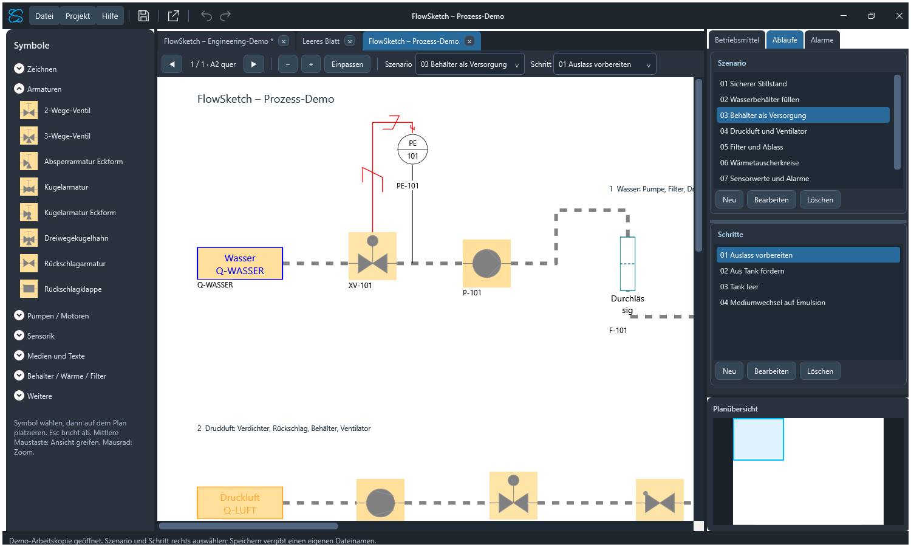

# FlowSketch

**Prozesspläne zeichnen, Medienwege darstellen und Szenarien mit Schritten dokumentieren.**

FlowSketch ist ein deutschsprachiger Windows-Editor mit WPF und .NET 10. Zeichnungen entstehen auf einem leeren Blatt oder als funktionelles Overlay auf einem R&I-/P&ID-PDF. Die Referenz-PDF bleibt unverändert; Verbindungen und Zustände werden in einer separaten Projektdatei gespeichert.

**Version 0.8.1** · [Bedienhilfe](docs/Hilfe.md) · [Projektstand und Prüfnachweise](ProjektZustand.md)



## Funktionen

- Leere Blätter in A4/A3/A2, Hoch-/Querformat und formfreie Arbeitsflächen mit Druck-/Exportrahmen; mehrere Dokumente in Tabs.
- Armaturen mit Antrieben, Pumpen, Kompressoren, Ventilatoren, Behälter, Wärmetauscher, Filter, Sensoren und Legenden sowie einfache Zeichenobjekte.
- Mehrteilige Rohrpfade, gebundene Abzweige, Sensoranschlüsse und grafische Wirk-/Regellinien.
- Projektmedien mit Typ, Farbe und automatischen Legenden; richtungsabhängige Medienweitergabe und Durchflussdarstellung.
- Szenarien mit Schritten, vererbten Zuständen und Schrittüberschreibungen. Der Tab „Abläufe“ vereint Szenarioauswahl und zugehörige Schritte.
- Sensorkennungen, Rohwertskalierung und LL/L/H/HH-Alarme.
- Mehrfachauswahl, Gruppen, gemeinsame Eigenschaften, projektübergreifendes Kopieren, Wildcard-Suche und bis zu 100 Undo-/Redo-Schritte je Dokument.
- Zoom zur Mausposition, Pan und navigierbare Planübersicht.
- PDF-/JPG-Export, Offline-Review-Paket mit Zoom und Excel-Aktorenliste nach Szenario, Schritt und Aktor.
- PDF-Hashprüfung und Engineering-Freigabe; Änderungen widerrufen die Freigabe.

FlowSketch stellt funktionelle Verbindungen dar. Es berechnet keine Hydraulik, Drücke oder Wärmeleistungen und verbindet sich nicht mit SPS oder HMI.

## Voraussetzungen

| Verwendung | Voraussetzung |
| --- | --- |
| Programm starten | Windows 10 ab Build 19041 oder Windows 11; .NET 10 **Desktop Runtime**, x64 |
| Quellen bauen | Windows und .NET 10 SDK |
| Viewer-/Hilfetests | Zusätzlich Node.js |

Die aktuelle Ausgabe benötigt eine separat installierte Desktop Runtime. Excel ist für den XLSX-Export nicht erforderlich.

## Aus Quellen starten

```powershell
git clone https://github.com/SchnDom/FlowSketch.git
cd FlowSketch
dotnet restore PID2Process.sln
dotnet run --project src/PID2Process/PID2Process.csproj
```

Beim Start erscheint ein leeres Zeichenblatt. **Hilfe → Demo öffnen** lädt eine unabhängige Arbeitskopie der eingebetteten Demo mit 37 Symbolen, 29 rechtwinkligen Rohrpfaden, sieben Szenarien und 26 Schritten. Erläuterung und Dateien: [examples](examples/README.md).

Die internen Solution-/Quellnamen `PID2Process` und die Dateiendung `.pid2process.json` bleiben aus Kompatibilitätsgründen erhalten. Programm- und Repositoryname lauten FlowSketch.

## Versionierte Ausgabe bauen

```powershell
./scripts/Publish-Release.ps1
```

Die Version stammt aus [PID2Process.csproj](src/PID2Process/PID2Process.csproj). Die Ausgabe liegt unter `bin/<Version>/FlowSketch.exe`, aktuell `bin/0.8.1/FlowSketch.exe`. Beispiele, Dokumentation und Diagnoseinformationen besitzen eigene Unterordner. Frühere Versionsordner bleiben erhalten; Builds sind nicht Bestandteil des Git-Repositories.

## Prüfen

```powershell
# Ohne Fensteranzeige oder Maus-/Tastatureingaben:
dotnet run --project src/PID2Process/PID2Process.csproj -c Release -- --model-test
node tests/review-scene.test.cjs
node tests/review-zoom.test.cjs

# Offline-Hilfe im versionierten Ausgabeverzeichnis prüfen:
./scripts/Publish-Release.ps1
node tests/help.test.cjs
```

Die Modellprüfung erzeugt ihre eigenen Fixtures und Renderbilder unter `test-results/`; die Viewerprüfung verwendet diese anschließend. Build, Modelltests, gespeicherte Renderbilder und echte Bedienabnahme sind getrennte Nachweise. Details stehen in [ProjektZustand.md](ProjektZustand.md).

Der optionale Parameter `--self-test` startet eine **sichtbare** Testinstanz und kann Fokus und Maus-Erfassung verändern. Er gehört nicht zur bildschirmfreien Prüfung.

## Bedienung in Kürze

| Aktion | Bedienung |
| --- | --- |
| Rohrpfad | R; Eckpunkte klicken; Enter/Doppelklick zum Abschluss |
| Abbrechen / Auswahl aufheben | Esc |
| Ansicht verschieben / zoomen | Mittlere Maustaste ziehen / Mausrad |
| Mehrfachauswahl | Auswahlrahmen oder STRG-Auswahl |
| Kopieren / Einfügen | STRG+C / STRG+V, auch zwischen Dokumenten |
| Rückgängig / Wiederholen | STRG+Z / STRG+Y; alternativ STRG+UMSCHALT+Z |
| Speichern / Speichern unter | STRG+S / STRG+UMSCHALT+S |
| Eigenschaften | Doppelklick oder Kontextmenü |
| Gerade verschieben / proportional skalieren | SHIFT beim Ziehen |
| Symbol kopieren / Rohrabzweig beginnen | STRG beim Ziehen |

## Verzeichnisstruktur

| Pfad | Inhalt |
| --- | --- |
| `src/PID2Process/` | WPF-Anwendung, Modell, Netzwerkauswertung und Review-Viewer |
| `docs/` | Bedienhilfe als gemeinsame Quelle für Programm und Offline-HTML |
| `_media/` | Firmenangaben, Markenbilder, generiertes ICO und Hilfebilder |
| `examples/` | Eingebettete Demo, Vorschau und Excel-Beispiel |
| `scripts/` | Versionierter Publish und Offline-Hilfeerstellung |
| `tests/` | Node-Regressionen für Viewer, Zoom und Hilfe |
| `ProjektZustand.md` | Projektfortschritt, Änderungen und Prüfnachweise |

Persönliche Projektdateien, Referenz-PDFs unter `_PIDs/`, Buildordner und Testartefakte bleiben lokal und sind durch `.gitignore` ausgeschlossen. Die ausdrücklich bereitgestellte Demo wird mit versioniert.

## Technik und Gestaltung

Positionen und Größen werden normiert gespeichert. PDF-Seiten werden beim Zoomen aus dem Original in passender Auflösung neu gerendert. Editor und SVG-Review verwenden gemeinsame Symboldefinitionen und übereinstimmende Szenario-/Schrittwerte.

Die dunkle Oberfläche orientiert sich an [CustomTkinter](https://github.com/TomSchimansky/CustomTkinter); die Implementierung bleibt WPF. Formgruppen und Fensterrahmen orientieren sich an den [Microsoft-Formularrichtlinien](https://learn.microsoft.com/en-us/windows/apps/design/controls/forms) und [WindowChrome](https://learn.microsoft.com/en-us/dotnet/api/system.windows.shell.windowchrome). Die bereitgestellten CS-Markenbilder sind die Quelle für Programmicon und Firmenwortmarke.
